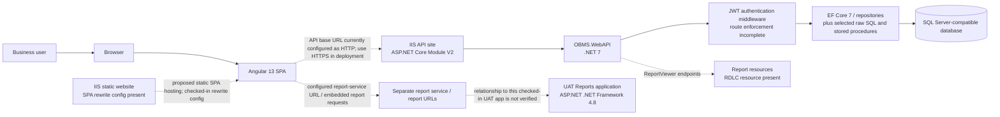
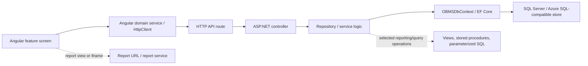
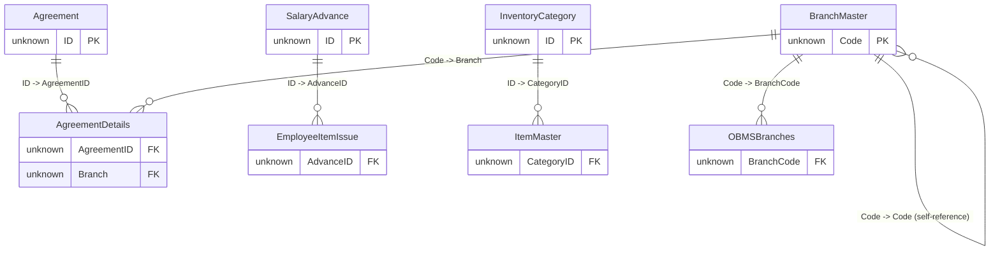
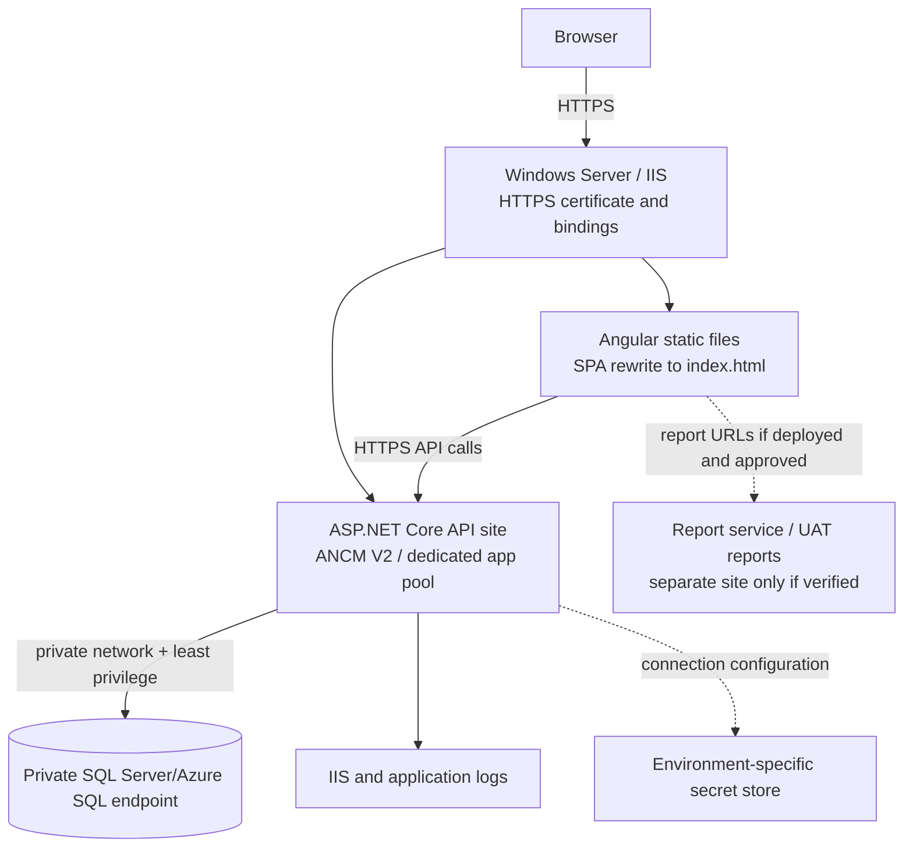

# OBMS — Technical Analysis and Architecture

**Repository:** `Dextra555/FWG-Malaysia-New`  
**Analysis basis:** checked-in source/configuration visible in the working tree on 27 October 2026. This is a static source review, not a production-environment inspection, penetration test, database restore, or performance test.

> **Sensitive-data handling:** credentials, tokens, keys, connection-string values, personal identifiers, and bank security values are intentionally omitted. Database name is stated only because it is explicitly present in the checked-in API configuration. Paths and evidence below identify source locations without reproducing secret values.
>
> **Worktree note:** the repository already contained unrelated modified and untracked application files when this documentation work began. Findings describe the current working-tree snapshot, including those files; no pre-existing application changes were reverted or modified for these deliverables.

## A. Executive summary

OBMS is an operational and financial business application for a Malaysian security-services business. The repository provides an Angular browser UI and an ASP.NET Core API covering employee and client/branch records, agreements, inventory, payroll operations, finance, accounting, administration, and reports. The exact product expansion of “OBMS” is not stated in the repository; “Operational Business Management System” is used here as a descriptive label, not a verified formal product name.

The UI dashboard itself describes the application as the “New OBMS System” and says legacy modules remain available for capabilities not yet migrated. This supports describing the system as an ongoing modernization/migration rather than claiming that every legacy workflow has moved to the new UI.

The main technical shape is:

- **Frontend:** Angular 13, with Angular Material and Bootstrap, feature modules, route guards, domain API services, charts, spreadsheet export, and embedded report views.
- **Backend:** ASP.NET Core Web API targeting .NET 7; controller/repository structure; EF Core 7 with SQL Server provider; some direct `DbContext`, stored-procedure, and raw-SQL access.
- **Data:** SQL Server-compatible configuration and EF Core model; a checked-in BACPAC represents an Azure SQL 12.0.2000.8 schema snapshot, not proof of the current production database. Manual SQL migration/report scripts are also present.
- **Reporting/deployment:** Bold Reports dependencies and a separate precompiled .NET Framework 4.8 UAT reports application are present. API IIS configuration and folder-publish profiles exist. These demonstrate IIS-oriented build artifacts, not that any particular production IIS deployment is live.

The highest-priority operational risks visible in source are inconsistent authentication enforcement, credentials handled without password hashing in the backend, a hard-coded JWT signing key, HTTP API/report URLs in the Angular production environment, permissive CORS, and a .NET 7 target that is out of support. These are source-level observations, not the result of a security audit. Treat deployment and database findings as configuration evidence only; confirm actual production topology, database state, and access controls before relying on them.

### Evidence conventions

| Label | Meaning |
|---|---|
| **Implemented** | Concrete UI/API/data code or configuration is present. It does not imply production readiness or successful runtime testing. |
| **Partial / needs verification** | Some source is present, but implementation is incomplete, inconsistent, not wired end-to-end, or not confirmed at runtime. |
| **Not found** | No evidence was identified in the inspected application source/configuration. This is not proof that no external process or undocumented feature exists. |

## 1. Product and business context

### Purpose and users

The implemented domains suggest that OBMS supports day-to-day operations of a security services company: branch and client setup, employee management, service agreements, guard attendance/payroll, inventory and issue tracking, invoicing/collections, accounting, and operational reports. This business-purpose statement is an inference from the screens, API routes, and data entities; a formal requirements/business-process document was not found in the inspected project.

Likely user groups inferred from the screens and routes include administrators, branch/operations staff, HR/payroll staff, inventory staff, finance/accounting staff, and report consumers. The repository does not provide a complete role catalogue or a verified authorization matrix.

### Main business workflows

1. Maintain branch, client, employee, salary/slab, and bank master data.
2. Create and maintain service agreements and agreement details; manage terminations.
3. Record employee attendance and payroll-related advances, loans, and miscellaneous transactions; run salary processing and view payslips/statements.
4. Maintain inventory categories, items, assets, suppliers, recipients, and material issues.
5. Prepare client invoices, payments, receipts, credit/debit notes, and legal-demand actions.
6. Review accounting information and operational, payroll, inventory, finance, and master-data reports.

Workflow existence is based on explicit routes and API operations. Approval/sign-off chains, notification delivery, and complete migration of legacy functions were **not established**.

## 2. System architecture

### C. High-level component diagram



### Component explanation and boundaries

- **Browser and Angular UI:** route-based application with login/admin layouts, feature screens, API services, and report views.
- **IIS static UI site:** a recommended deployment boundary for Angular build output. A source SPA rewrite rule exists, but the production build does not copy `src/web.config` into `dist/angularapp`; a production IIS site/binding/deployment record for the UI was not confirmed.
- **IIS API site:** an ASP.NET Core Module V2 configuration is checked in for the API, with `dotnet .\OBMS.WebAPI.dll` and in-process hosting. The file is evidence of IIS configuration, not a live site.
- **API/application:** controllers dispatch domain requests to repositories and, in some places, directly to `OBMSDbContext`.
- **Authentication:** JWT bearer middleware is enabled. The frontend guard tests for token presence; backend controllers do not consistently require authorization attributes.
- **Database:** the API configures the EF Core SQL Server provider. The BACPAC is an Azure SQL schema export snapshot; its relationship model is not necessarily the currently configured or production database.
- **Reports:** the UI has a separately configured report base URL and embeds report pages. The API also contains a Bold Reports controller. A separate .NET Framework 4.8 UAT reports application exists in the repository, but the actual runtime relationship among these pieces is not established.
- **File storage and external integrations:** no dedicated file-storage service, outgoing mail/messaging integration, or external service client was identified in the API source. A report resource directory and report URLs are present.

### D. Frontend-to-backend-to-database flow



Representative end-to-end mappings:

| UI action | API mapping | Backend/persistence mapping |
|---|---|---|
| Employee list/form | `Employee/Employees` (GET); `Employee/SaveAndUpdateEmployee` (POST) | `EmployeeController` → employee repository/`OBMSDbContext` → employee/related employment entities. |
| Attendance entry | `payroll/SaveAndUpdateAttendance` (POST) | Payroll controller/repository and attendance model; `Attendance` and `AttendanceDetails` are in the BACPAC snapshot and EF model. |
| Inventory item form | `Inventory/SaveAndUpdateItem` (POST) | `InventoryController` → inventory repository → `ItemMaster` and `InventoryCategory` model/tables. |
| Agreement list/form | `Agreement/GetAgreements`, `Agreement/GetAgreementByID`, `Agreement/SaveAndUpdateAgreement` | `AgreementController`/repository → `Agreement` and `AgreementDetails`. |
| Invoice and payment screens | `Finance/GetInvoiceMaster`, `Finance/SaveAndUpdateInvoice`, `Finance/GetPaymentMaster`, `Finance/SaveAndUpdatePayment` | `FinanceController` and finance repository/direct context → invoice/payment models. `ClientInvoice`, `InvoiceDetails`, and related invoice entities are present in the schema/model evidence. |
| General ledger report | `master/GetBranchListByUserName` supplies branch options; report is embedded from the configured report service, not the accounting API | Accounting report endpoint/report service and database query/view; exact deployed report-to-database wiring requires confirmation. |

The UI-to-route examples are verified in the service code; controller/repository behavior is verified in the corresponding backend sources. Database table naming can differ between the BACPAC snapshot and later EF/SQL scripts, so confirm the deployed schema before treating a table mapping as authoritative.

## 3. Frontend and UI

### Framework and structure

- **Framework:** Angular `~13.3.0`; Angular CLI/build tooling `~13.3.6`; the generated UI README names Angular CLI 13.3.6.
- **Languages:** TypeScript `~4.6.2`, HTML templates, CSS/SCSS.
- **Libraries:** Angular Material/CDK 13.3.x, Bootstrap 4, RxJS 7.5, Bold Reports Angular components 5.3.x, ApexCharts/ng-apexcharts, Chart.js/ng2-charts, `xlsx`, FileSaver, SweetAlert2, CryptoJS, and `jwt-decode`.
- **Main folders:** `src/app/layout` (auth/admin layouts and routes), `src/app/modules` (business features/screens), `src/app/service` (API services, auth guard/interceptor), `src/app/shared` (reusable UI), `src/app/model` (client-side models), `src/environments` (development/production settings).
- **Root routing:** auth and admin layouts are lazy-loaded; admin routes cover dashboards and feature pages. The admin feature routes are guarded by `AuthGuard`.
- **Screens/domains:** dashboard; branches, clients, employees, employee history/transfer, shifts and statutory/salary slabs; agreements and terminations; inventory; payroll and attendance; administration; finance; master/payroll/inventory/finance/accounting reports.
- **Representative routes:** `/login`, `/register`, `/changepassword`; `/dashboard`; `/master/branch-master`, `/master/client-master`, `/master/employee-master`, `/master/employee-transfer`; `/quotation-and-agreement/agreements` and `/quotation-and-agreement/agreement-termination`; `/inventory/item-master`, `/inventory/asset-master`, `/inventory/material-issue`; `/payroll/new-attendance`, `/payroll/salary-processing`, `/payroll/new-employee-monthly-advance`; `/administration/user-registration`; finance screens under `/finance/...`; and report routes under `/report/payroll`, `/report/finance`, `/report/accounting`, plus master/inventory report prefixes.

### Navigation, authentication, and validation

- Login, registration, and password-change routes exist. The login form applies required-field checks, hashes its submitted password in the browser, calls the login API, and stores the returned token. The frontend also stores the entered password in session storage for the password-change flow; this should be removed in favor of a server-side, authenticated password-change design.
- `AuthGuard` checks whether a token is present and redirects to login if absent. This is a client-side navigation guard, not a substitute for API authorization or a role/permission check.
- An HTTP interceptor attaches/uses the token and logs out on HTTP 401. The inactivity timer's configured duration and its inline comment differ.
- Reactive forms and Angular validators are present on data-entry screens. Backend DTO validation is not consistently enforced, so frontend validation alone must not be trusted.
- Role-based screen/menu authorization is not established by the guard implementation. A permissions model exists in the source/data model, but that alone does not establish access control.

### API communication and reporting

Domain-specific services call the backend through Angular `HttpClient` using the environment API base URL. The production environment currently contains HTTP API/report base URLs; exact host values are intentionally omitted here. The production build replaces the environment configuration.

Reporting screens use a mixture of:

- Angular report components / report-service URLs embedded in iframes;
- API/report endpoints, including `ReportViewerController`;
- spreadsheet export from selected screens/reports.

The generic `report/:ReportName` screen contains only limited report-name URL handling; the two explicit cases both append the same branch report path. Treat generic report routing as partial until every report case has been verified.

## 4. Backend and APIs

### Framework, code structure, and dependencies

- **Framework:** ASP.NET Core Web API, target framework `net7.0`; C# with nullable reference types and implicit usings.
- **Key packages:** EF Core/SQL Server 7.0.13; JWT bearer 7.0.0; Swashbuckle.AspNetCore 6.5.0; BoldReports.Net.Core 5.3.10; Microsoft OpenAPI 7.0.14; System.Data.SqlClient 4.8.6.
- **Layers:** `Controllers`, `Repositories/Interface`, `Repositories/Implementation`, `Models/Domain`, `Models/DTO`, `Models/OBMSDbContext.cs`, `BusinessObjects`, `Reports`, and `Utility`.
- **Startup:** registers `OBMSDbContext`, controllers, Swagger, repositories/services, CORS, authentication and authorization middleware. Some controllers use repositories; finance and other paths also directly use the context.
- **Data access:** EF Core is the main ORM. Selected operations call stored procedures or parameterized/raw SQL. This is a mixed pattern rather than a strict controller → service → repository-only architecture.

### Controller/API coverage

Most controllers use `api/[controller]`; the report viewer uses `api/[controller]/[action]`. These are representative routes/operations, not a complete OpenAPI inventory.

| Controller / route group | Implemented operations observed | Request/response characteristics |
|---|---|---|
| `RegisterController` (`api/Register/...`) | Register/login, password change, user lookup/list/delete, bank list | Login issues a token; response shapes include a dictionary and user data. Password-change request DTO has required-field annotations. |
| `MasterController` (`api/Master/...`) | Branch/client listing, lookups, save/update/delete, user-scoped branch listing | Typed and untyped responses are mixed. |
| `EmployeeController` (`api/Employee/...`) | Employee number/listing, branch filtering, ID lookup, save/update operations | Employee form/list flows use GET and POST service methods. |
| `AgreementController` (`api/Agreement/...`) | Agreement/client list, detail, save/update/delete, termination-related operations | Agreement DTOs and repository paths are present. |
| `InventoryController` (`api/Inventory/...`) | Category/item list, save/update, lookup by ID/category | Inventory request and result models are used. |
| `PayrollController` (`api/Payroll/...`) | Employee/advance lookups, monthly advance, item-issue submission and retrieval; attendance API is used by the UI | Payroll DTOs and repository operations; verify the exact deployed route set against generated API documentation. |
| `FinanceController` (`api/Finance/...`) | Invoice/client lists, agreement/invoice detail, batch/invoice/detail save, payments and receipts | Includes direct context access, SQL operations, and inconsistent response/error conventions. |
| `AccountingController` (`api/Accounting/...`) | GL list/existence, add/delete, optional type filters | Accounting repository and GL/report DTOs. |
| `CreditDebitNoteController` (`api/CreditDebitNote/...`) | Note list/lookup/number generation/save/update/delete | Credit/debit-note DTOs and corresponding repositories. |
| `ReportViewerController` (`api/ReportViewer/...`) | Report POST processing and GET resource retrieval | Bold Reports integration is present but its report-file stream logic appears defective; do not assume working report rendering from code presence alone. |
| `WeatherForecastController` | Template forecast endpoint | Framework sample, not a business module. |

Across controllers, HTTP methods include GET and POST, with update/delete operations also present. DTOs, `ActionResult`, `IActionResult`, `Object`, dictionary, and `HttpResponseMessage`-style patterns are mixed. A complete formal API contract or generated OpenAPI snapshot was not included in the repository review.

### Expanded active endpoint inventory

The following inventory covers public controller actions with active HTTP/route attributes found during source inspection; commented-out actions are excluded. Unless noted, route shape is `api/{Controller}/{Action}`. Scalar parameters are generally query-bound unless explicitly marked as a route or body parameter. This catalog names routes and request types; response payloads remain action-specific and the source uses typed `ActionResult<T>`, `ActionResult<Object>`, `IActionResult`, and `object` conventions.

| Controller | GET action suffixes | POST action suffixes | Explicit body/request models and notes |
|---|---|---|---|
| `AccountingController` | `GetList`, `GetListWithType`, `exists`, `exists-with-type` | `add`, `delete` | `add` accepts `List<AccountGLReportDto>` and `currentUser`; writes may return explicit HTTP 500 responses. |
| `AgreementController` | `GetAgreementMaster`, `GetClientsAgreementByBranchID`, `GetClientsOnlyByBranchID`, `GetClientsAllStatusByBranchID`, `GetAgreementByID`, `GetAgreements`, `CheckClientStatus`, `GetFinalInvoiceDate`, `GetAgreementsDiscountReportMaster`, `GetAgreementsDiscountReport`, `GetAgreementTerminationList`, `GetAgreementListByBranchId`, `GetAgreementTerminationByID`, `GetInvoiceDate/{agreementId}`, `IsInvoiceAvailable/{agreementId}` | `SaveAndUpdateAgreement`, `DeleteAgreementDetailById`, `DeleteAgreementById`, `SaveAndUpdateAgreementTermination` | Save types: `AgreementRequestDto`, `TerminatedAgreementRequestDto`. `{agreementId}` is `int` for `GetInvoiceDate`, `decimal` for `IsInvoiceAvailable`. |
| `CreditDebitNoteController` | `GetCreditNotes`, `GetCreditNoteById`, `GenerateCreditNoteNo`, `GetDebitNotes`, `GetDebitNoteById`, `GenerateDebitNoteNo`, `GetApprovedCreditNotesByClient`, `GetApprovedDebitNotesByClient` | `SaveCreditNote`, `UpdateCreditNote`, `DeleteCreditNote`, `SaveDebitNote`, `UpdateDebitNote`, `DeleteDebitNote` | Write types: `CreditNoteRequestDto`, `DebitNoteRequestDto`; reads return note entities/lists and delete returns `bool`. |
| `EmployeeController` | `EmployeeNoByBranchID`, `Employees`, `EmployeesByBranchId`, `EmployeeById`, `GetEmployeeMaster`, `GetClientsFromBranchId`, `GetEmployeeNo`, `GetSalarySlabList`, `CheckEmployeeInfo`, `GetAllEmployeesWithHistory` | `SaveAndUpdateEmployee`, `UpdateEmployeeTransfer` | Write types: `EmployeeRequestDto`, `EmployeeTransferDto`; `EmployeeById` takes integer `employeeId`. |
| `FinanceController` | `GetInvoiceMaster`, `GetInvoiceClientByBranchAndInvoiceDate`, `GetBatchInvoiceClientByBranchAndInvoiceDate`, `GetAgreementAndDetailsByBranchInvoicePeriodAndClient`, `GetInvoiceAndDetailsByInvoiceId`, `GetAgreementDetailsByAgreementId`, `DeleteInvoiceById`, `DeletedInvoiceListByBranchId`, `PrintInvoice`, `GetPaymentMaster`, `GetPaymentMasterCategoryType`, `GetPaymentMasterCategoryTypeChangePayTo`, `GetPaymentSupplierInvoices`, `creditor-invoice-payment-details`, `creditor-invoice-payment-details-by-supplier`, `branch-payment-details`, `GetReceiptMaster`, `GetReceiptInvoiceByClient`, `invoice-details`, `GetClientByBranch`, `CheckUniqueChequeNoWithReceiptsNotDeleted`, `GetReceiptDetailRowAmount`, `GetSuppliers`, `GetInventoryCategories`, `monthly-invoices`, `GetMonthlyInvoiseList`, `GetList`, `GetListWithBranch`, `GetByDateAndBranch`, `GetByBankAndCheque`, `{id}`, `byDate`, `byBankAndCheque`, `byPaymentID/{id}`, `GetNextChequeNumber`, `GetNoOfCheques`, `InventoryCategoryList`, `PaymentRecycleBin`, `cheque-status`, `GetLegalDemandList`, `GetLegalDemandByID/{id}`, `GetPaymentListByCategory`, `GetBranchPaymentsTotalAmountByCategory`, `NewClientInvoiceNo`, `GetListByBranchAndInvoice`, `GetBranchPaymentVoucherSummary`, `GetSeparatedProfitLoss` | `SaveAndUpdateBatchInvoice`, `SaveAndUpdateInvoice`, `SaveAndUpdateInvoiceDetail`, `DeleteInvoiceDetailById`, `RestoreInvoices`, `SaveAndUpdatePayment`, `SaveAndUpdateReceipt`, `delete`, `DeletePaymentLine`, `receipt/delete`, `restore-multiple`, `restore-chequeStatus`, `saveOrUpdateLegalDemand`, `DeleteLegalDemand/{id}`, `client-statement`, `supplier-report` | Request types include `ClientBatchInvoiceRequestDto`, `ClientInvoiceRequestDto`, `BranchPaymentRequestDto`, `ReceiptsRequestDto`, `DeletePaymentRequest`, `RestoreMultipleRequest`, `RestoreChequeStatusRequest`, `ClientLegalDemandAction`, `ClientStatementRequest`, and `ClientActivityReportRequest`. `{id}` route variables are integers. Notably, `DeleteInvoiceById` is exposed as GET. |
| `InventoryController` | `GetInventoryCategories`, `GetInventoryCategoryByID`, `GetInventoryItemMaster`, `GetCategoriesByCat`, `GetInventoryItems`, `GetInventoryItemByID`, `GetAssetMasters`, `GetInventoryAssetByID`, `GetSupplierCode`, `GetSuppliers`, `GetSupplierByID`, `GetRecipientMaster`, `GetRecipients`, `GetRecipientByID`, `GetUtilityBillsMasterList`, `GetPaytoByCategory`, `GetUtilityMasterList`, `GetUtilitySearchList`, `GetUtilityBillSearchList`, `GetUtilityDetailsByID`, `GetUtilityDetailListByInvoiceId`, `GetItemByCategoryId`, `GetMaterialMasterList`, `GetMaterialInvoiceByBranch`, `GetMaterialInvoiceItemByCategoryID`, `GetMaterialSearchList`, `GetMaterialDetailListByInvoiceId`, `GetReportHQMaster`, `CreditorInvoice_CheckOnBranchPayments/{invoiceID}`, `DeleteExpensesByID/{id}` | `SaveAndUpdateCategory`, `SaveAndUpdateItem`, `SaveAndUpdateAssetMaster`, `SaveAndUpdateSupplier`, `SaveAndUpdateRecipient`, `SaveAndUpdateUtility`, `DeleteUtilityDetailById`, `SaveAndUpdateMaterial`, `DeleteItem/{id}`, `DeleteAsset/{id}`, `DeleteRecipient/{id}`, `DeleteCategory/{id}`, `DeleteSupplier/{id}` | Request types include `InventoryCategoryDto`, `ItemMasterDto`, `AssetMasterRequestDto`, `SupplierRequestDto`, `RecipientRequestDto`, `CreditorInvoiceRequestDto`, and `StockIssuesRequestDto`. Route IDs are integers except `invoiceID` (`decimal`). |
| `MasterController` | `GetBranchMasterAll`, `GetBranchMaster`, `GetBranchListByUserName`, `GetBranchMasterCode`, `GetClientMsterList`, `GetClientMsterListByStatus`, `GetClientMsterListByBranch`, `GetNClientMasterCode`, `GetClientBreakList`, `GetShiftMsterList`, `GetEPFMaster`, `GetSIPMaster`, `GetIncomeTaxMaster`, `GetLeaveMaster`, `GetSOCSOMaster`, `GetSalaryMaster`, `GetSalaryListByStatus`, `GetKKDNListView`, `GetKKDNList`, `GetEmployeeVisaPassportList` | `SaveAndUpdateBranchMaster`, `DeleteBranchMasterByCode`, `SaveAndUpdateClientMaster`, `DeleteClientMasterByCode`, `SaveClientBreaks`, `DeleteClientBreakById`, `SaveAndUpdateShiftMaster`, `DeleteShiftMasterById`, `SaveAndUpdateEPFMaster`, `DeleteEPFMasterById`, `SaveAndUpdateSIPMaster`, `DeleteSIPMasterById`, `saveAndUpdateIncomeTaxMaster`, `DeleteIncomeTaxMasterById`, `saveAndUpdateLeaveMaster`, `DeleteLeaveMasterById`, `SaveAndUpdateSOCSOMaster`, `DeleteSOCSOMasterById`, `saveAndUpdateSalaryMaster`, `DeleteSalaryMasterById` | Request types include `BranchMasterRequestDto`, `ClientMasterRequestDto`, `List<ClientBreakDto>`, `ShiftTimeMasterDto`, `EPFRequestDto`, `SIPRequestDto`, `IncomeTaxRequestDto`, `LeaveSystemRequestDto`, `SOCSORequestDto`, and `SalaryStructureDto`. |
| `PayrollController` | `GetEmployeeList`, `GetEmployeeListBySalaryAdvance`, `GetEmployeeListByBranchCode`, `GetEmployeeListByAdvanceID`, `GetListByEmplyeeType`, `GetEmployeeAdvanceList`, `GetInventoryCategories`, `GetSalaryAdvanceById`, `GetEmployeeById`, `GetNewVoucherNumberAsync`, `GetUniformItemRows`, `GetSalaryProcessDateByEmployeeID`, `GetResignDate`, `misc-trans`, `GetMiscTrans`, `GetMiscTransById`, `GetDailyAdvanceList`, `GetEmployeeNo/{employeeId}`, `GetEmployeeLoanById`, `GetClients`, `AttendanceByEmployeeID`, `GetAttendanceWorkTypeList`, `AttendanceDetailsByID`, `GetAttendanceDetailsList`, `GetEmployeeDetails`, `IsSalaryProcessDoneForCurrentPeriod`, `GetEmployeeAttendanceList`, `IsTemporaryEmployee`, `GetTemporaryEmployeeList`, `GetAnnualLeave`, `GetMedicalLeave`, `GetMaternityLeave`, `GetPaternityLeave`, `GetHospitalizationLeave`, `CalculateAge`, `GetAttendanceDisplayList`, `GetList`, `getListByEmployee`, `getListEmployeeByClient`, `LastprocessedDate`, `LastSalaryProcessRemarks`, `Process`, `WithBlankRow`, `WithBlankRowByBranch`, `WithBlankRowByBranchAndEmployeeType`, `WithBlankRowByBranchAndEmployeeTypeAndBank`, `GetEPFToExcel`, `GetEmployeeSocsoList`, `GetEmployeeSIPList`, `GetConfig`, `GetEPFToCIMBList`, `GetSocsoToCIMBList`, `GetSIPToCIMBList`, `GetEmployeeSalarynAdvanceList`, `GetEmployeeSalarynAdvanceListWithBranch`, `GetEmployeeSalarynAdvanceTotalList`, `GetEmployeeSalarynAdvanceTotalListWithBranch`, `GetEmployeeSalarynAdvanceHashTotalList`, `GetEmployeeSalarynAdvanceHashTotalListWithBranch`, `ClientInvoiceCalculation`, `ClientInvoiceCalculationByAgreementId`, `GetMonthlyInvoiceStatusList`, `CheckExistAdvance`, `NewAdvanceVoucherNo`, `GetSalaryAdvances`, `latest-period`, `GetEmployeeLoanList`, `GetSalaryList` | `SaveAndUpdateSalaryMonthlyAdvance`, `SaveEmployeeItemIssues`, `GetSalaryAdvanceByDateAndEmployee`, `SaveAndUpdateMiscTrans`, `DeleteMiscTransById`, `SaveAndUpdateSalaryDailyAdvances`, `SaveAndUpdateAttendance`, `DeleteAttendance`, `Delete/{id}` | Explicit request/model types include `SalaryAdvanceRequestDto`, `List<EmployeeItemIssueDto>`, `SalaryAdvance`, `MiscTransDto`, and `AttendanceModel`. `{employeeId}` and `{id}` are integers. |
| `RegisterController` | `GetObmsusers`, `GetObmsuserById`, `GetObmsuserByName`, `GetBankList`, `GetUserBankList`, `GetBankListById`, `GetBankListByUserId`, `GetBankMasterList`, `GetUserBankMaster`, `GetBankMasterById`, `GetBankPrefixNoByBankID`, `GetChequeList`, `GetUserChequeList`, `GetChequeListById`, `GetUsers`, `GetScreensByCategory`, `GetPermissionsWithScreens`, `GetObmsBranchesPermission`, `GetObmsBranchesPermissionByUser`, `GetObmsBanksPermission`, `GetObmsBankMasterPwrmission`, `GetBankShortName/{bankID}`, `GetUserAccessRights` | `UserRegistration`, `LoginUser`, `changepassword`, `DeleteObmsuser`, `DeleteBank`, `saveAndUpdateBankDetails`, `DeleteBankMaster`, `saveAndUpdateBankMasterDetails`, `DeleteChequeMaster`, `saveAndUpdateChequeMasterDetails`, `SaveAndUpdateObmsPermissions`, `SaveAndUpdateObmsBranches`, `SaveAndUpdateObmsBanks` | Request types include `CreateRegisterRequestDto`, `LoginRequestDto`, `ChangePasswordRequestDto`, `BankList`, `BankMasterDto`, `ChequeMasterDto`, `List<OBMSPermissionDto>`, `List<OBMSBranchesDto>`, and `List<OBMSBanksDto>`. `{bankID}` is `decimal`. |
| `ReportViewerController` | `GetResource` | `PostReportAction`, `PostFormReportAction` | `PostReportAction` accepts `Dictionary<string, object>`; `GetResource` accepts `ReportResource`; responses are `object`. |
| `WeatherForecastController` | Template forecast action | — | No explicit request model; returns `IEnumerable<WeatherForecast>`. |

The inventory is based on active route attributes in the controller sources. Confirm parameter binding, response payload details, and route casing against the running API/OpenAPI output before building external clients. The GET-based `DeleteInvoiceById` is a notable HTTP-semantics issue to address.

### Business logic, validation, errors, and logging

- Domain logic is primarily implemented in repositories and large controllers; `ISalaryProcess`/`SalaryProcess` is registered for salary processing.
- DTO validation is partial. Startup suppresses implicit required validation for non-nullable reference properties.
- No shared exception-handling middleware or consistent structured logging was identified. Controllers variously rethrow, return HTTP 500 responses, expose exception messages, or catch errors and return success-shaped results.
- `ILogger` usage was found in the sample weather endpoint; broader operational logging/monitoring was not established.
- Swagger is enabled by the startup code without an environment gate; access should be reviewed before production exposure.
- Background-job scheduling, outbound email/SMS, and other external service clients were not found in the application source.

## 5. Database

### Engine, database name, and source of schema evidence

- The API uses the EF Core SQL Server provider and `ConnectionStrings:obms`.
- The checked-in [`appsettings.json`](./OBMSAPP-API/OBMS.WebAPI/appsettings.json) explicitly identifies the configured catalog as **`OBMSUATNEW`**. This is a checked-in configuration value, not confirmation of the production database name or actual live connection.
- `OBMSAPP-UI/obmsadmin.bacpac` metadata identifies an **Azure SQL** source at version **12.0.2000.8** (`SqlAzureV12`). It is a historical schema snapshot, not proof that the API's configured SQL Server instance is the same environment or version.
- The BACPAC model reports 39 tables, 6 foreign-key constraints, 36 primary-key constraints, 6 unique constraints, 1 index, and 82 default constraints. Later checked-in SQL scripts add objects/indexes, so the snapshot counts must not be treated as the current deployed totals.

### ORM, entities, objects, and database access

`OBMSDbContext` exposes business entities including employees, clients, branches, agreements, payroll, inventory, invoices, receipts, accounting, attendance, and credit/debit notes. It also exposes keyless result models and maps selected models to views/query results. EF Core access coexists with raw SQL and stored-procedure calls. Connection retry is enabled via `EnableRetryOnFailure`.

The BACPAC snapshot table names are:

`Agreement`, `AgreementDetails`, `AssetMaster`, `Attendance`, `AttendanceDetails`, `BankList`, `BankMaster`, `BranchMaster`, `ChequeMaster`, `ClientInvoice`, `ClientMaster`, `EPF`, `Employee`, `EmployeeHistory`, `EmployeeItemIssue`, `EmployeeSalaryDetails`, `EmploymentDetails`, `IncomeTax`, `InventoryCategory`, `ItemMaster`, `LeaveSystem`, `MiscTrans`, `OBMSBranches`, `OBMSPermissions`, `OBMSUsers`, `PaySlip`, `RECEIPIENT`, `SIP`, `SOCSO`, `SalaryAdvance`, `SalaryProcess`, `SalaryProcessAudit`, `SalaryStructure`, `ScreenList`, `ShiftTimeMaster`, `Suppliers`, `TerminatedAgreements`, `__EFMigrationsHistory`, and `oSalaryStructure`.

Important caveat: this list is from the BACPAC, while the current EF context and later migrations expose additional entities/objects (including attendance audit and employee-history structures). Names such as `OBMSUsers`/`Obmsuser` and older salary structures are not assumed to be interchangeable.

### Relationships and Mermaid ER diagram

The six declared relationships in the BACPAC snapshot are listed below. A foreign key does not establish that the current live database matches the export. Column data types, nullability, and enforced cardinality were not verified; four relationships are reported as untrusted in the snapshot. Mermaid ER connectors below use conventional parent-to-child notation for readability and should be treated as provisional cardinality, not a verified schema guarantee.



The relationship lines reflect the declared FK pairings. Verify optionality, physical cardinality, and trust/enforcement against the actual target database before using the diagram for migration or integrity decisions.

### Views, scripts, indexes, and migrations

The SQL scripts include views/queries for branch payment vouchers, employee expiry reminders and visa/passport lists, sales invoice collections, separated profit/loss, and credit/debit-note summaries. Selected exact view names include `VWBranchPaymentVoucherSummary`, `VWEmployeeExpiryReminder`, `VWEmployeeVisaPassportList`, `VWSalesInvoiceCollectionByMonthBranch`, and `VWSeparatedProfitLoss`.

Other migration scripts cover client breaks/patrol flags, attendance audit trails, credit/debit notes, employee transfer history, salary/payroll contributions, visa/passport expiry, and payroll screen lists. The credit/debit-note script adds filtered unique/index structures. Several scripts use existence checks, but they are not uniformly safe to rerun. No current API EF migration source files were found in the designated `OBMSAPP-API/Database/Migrations` directory. The BACPAC includes `__EFMigrationsHistory`, which alone does not prove which migrations or scripts are applied to a live environment.

No database function or trigger inventory was established from the inspected scripts. Some repositories call stored procedures, but this repository does not provide a complete authoritative stored-procedure catalogue. Explicit transaction boundaries, backup schedules, and recovery procedures were not established.

### Important table purposes (inferred from names and code paths)

| Table/entity group | Business purpose |
|---|---|
| `BranchMaster`, `ClientMaster`, `OBMSBranches` | Branch/client and user-to-branch context. |
| `Employee`, `EmploymentDetails`, `EmployeeSalaryDetails`, `EmployeeHistory` | Workforce identity, employment assignment, salary details, and history. |
| `Agreement`, `AgreementDetails`, `TerminatedAgreements` | Service agreements, details, and termination records. |
| `Attendance`, `AttendanceDetails`, `SalaryProcess`, `SalaryAdvance`, `PaySlip`, `MiscTrans` | Attendance, payroll processing, advances, payslips, and payroll adjustments. |
| `InventoryCategory`, `ItemMaster`, `AssetMaster`, `EmployeeItemIssue`, `Suppliers`, `RECEIPIENT` | Inventory catalogue, assets, stock issues, suppliers, and recipients. |
| `ClientInvoice`, `InvoiceDetails`/invoice detail entities, `ChequeMaster`, `BankMaster`, `BankList` | Client billing and related banking/payment records. |
| `OBMSPermissions`, `ScreenList`, `OBMSUsers` | User/screen/permission-related structures; source presence does not establish effective authorization enforcement. |

## 6. Functional analysis and module matrix

| Module | Purpose/features and user actions observed | UI → API → logic/data path | Status / caveats |
|---|---|---|---|
| Dashboard | Entry point, dashboard content and migration messaging. | Angular dashboard; API calls depend on dashboard component/service. | **Implemented** as a screen. Dashboard marketing claims (speed/security) are not independently validated. It states legacy modules remain available. |
| Master data | Maintain branches, clients, employees, transfers/history, shift timing, statutory and salary slabs. | Employee list/form → `Employee/Employees` GET and `Employee/SaveAndUpdateEmployee` POST → controller/repository/EF entities. Branch/client operations are in `MasterController`. | **Implemented** UI/API operations; complete field-level validation and role scoping need verification. |
| Agreements | List, create/edit, detail, discounts, termination. | Agreement service → `Agreement/GetAgreements`, `GetAgreementByID`, `SaveAndUpdateAgreement` → agreement controller/repository → `Agreement`/`AgreementDetails`. | **Implemented** core screens/routes and API operations. Approval workflow was **not found**. |
| Inventory | Categories, items, assets, suppliers, recipients, bills, material issue. | Item form → `Inventory/SaveAndUpdateItem` POST → inventory controller/repository → item/category entities. | **Implemented** screens and core item/category API. End-to-end behavior for every inventory screen not individually verified. |
| Payroll and attendance | Attendance entry/display; salary processing; daily/monthly advances; loans; misc transactions; salary and statutory reports. | Attendance form → `payroll/SaveAndUpdateAttendance` POST → payroll logic/attendance entities. Other payroll operations are in `PayrollController` and `PayrollRepository`. | **Implemented/partial**: broad UI and API coverage; payroll outcomes and calculation correctness were not tested. |
| Administration and access | User registration, bank/cheque master, user/branch/screen access pages. | Auth/common/master services and `RegisterController`/`MasterController`. | **Partial**: screens/data structures exist, but server authorization is not consistently enforced. |
| Finance | Invoices, payments, receipts, cheque status, legal demand actions, credit/debit notes. | Finance UI/service → `Finance/...`; note screens → `CreditDebitNote/...` → repositories/context/SQL. | **Implemented** major routes and screen families; exception/response behavior is inconsistent. No external payment gateway integration was found. |
| Accounting | General ledger and related accounting lists/reports. | Accounting service includes list/add routes; general ledger UI loads branch list then embeds report service. | **Partial**: route/service/report pieces exist; report runtime/data source wiring is not established. |
| Reporting | Payroll, master, finance, inventory, and accounting reports; some spreadsheet exports. | Angular report screen → report-service URL/iframe or API report viewer; selected reports use spreadsheet export. | **Partial**: report screens/integrations exist; generic route handling and backend report resource loading are incomplete/defective as written. |
| Notifications / approvals / external communications | Email, SMS, approval orchestration, external business integrations. | No verified end-to-end path found. | **Not found** in application source. |

### Representative user workflows

These sequences describe the source-supported UI/API path; they are not claims about production process approvals or service-level behavior.

1. **Master records:** Open the guarded branch/client/employee screen → search or open the list → create/edit a record in a validated form → the domain service issues a GET or POST request → the controller/repository persists or retrieves data through EF Core → the UI consumes the response. Employee examples are `Employee/Employees` and `Employee/SaveAndUpdateEmployee`.
2. **Agreements:** Open the agreement list → load agreement data → choose create or edit → for edit, retrieve the agreement by ID → enter agreement/details in the form → call `Agreement/SaveAndUpdateAgreement` → repository persists the agreement records → return to the list/detail screen. A separate approval step is not evidenced.
3. **Inventory item:** Open item/category screens → select an item or start a new form → enter/update item fields → submit through `Inventory/SaveAndUpdateItem` → controller/repository persists through the inventory model/context → use the list/lookup screen to review. Other inventory pages are routed, but their complete paths were not individually verified.
4. **Attendance/payroll:** Open attendance entry → enter attendance information → submit via `payroll/SaveAndUpdateAttendance` → payroll logic and attendance entities handle the request → review attendance/salary-processing/report screens. Salary calculation correctness and actual payroll run controls were not runtime-tested.
5. **Finance:** Open invoice/payment/receipt screens → load invoice, client, agreement, or payment data → enter or update transaction details → submit through `Finance/...` actions → controller/repository/context or selected SQL path processes the request → review the resulting list/detail/report. Exact transaction, reconciliation, and approval controls require business-owner confirmation.
6. **Reporting:** Open a report screen → choose available filters/criteria → the UI calls a report endpoint or embeds a configured report-service URL → report rendering/query runs outside or inside the API depending on the selected screen → view/print/export where implemented. The report-server ownership and every report's deployed data source are unconfirmed.

## 7. Technology stack

| Layer | Technology | Version evidenced | Purpose | Evidence |
|---|---|---|---|---|
| Frontend framework | Angular | `~13.3.0` | Browser SPA and feature modules | `OBMSAPP-UI/angularapp/package.json`; Angular CLI README/config |
| Frontend language/tooling | TypeScript / Angular CLI | `~4.6.2` / `~13.3.6` | Compile, serve, test | `OBMSAPP-UI/angularapp/package.json` |
| UI components/styles | Angular Material/CDK; Bootstrap | `^13.3.9`; `^4.0.0` | Forms, components, responsive styling | `OBMSAPP-UI/angularapp/package.json` |
| Charts/export | ApexCharts, Chart.js, `xlsx`, FileSaver | Package versions in `package.json` | Charts and spreadsheet/file export | `OBMSAPP-UI/angularapp/package.json` |
| Reporting | Bold Reports Angular and .NET | `^5.3.9`; `5.3.10` | Report viewer/UI and API integration | UI `package.json`; API `.csproj` |
| Backend framework | ASP.NET Core Web API / .NET | `net7.0` | REST-style application/API | `OBMSAPP-API/OBMS.WebAPI/OBMS.WebAPI.csproj` |
| Backend language | C# | Language version not explicitly pinned | Controllers, repositories, models | `.csproj` and `.cs` sources |
| ORM/database provider | EF Core / SQL Server provider | `7.0.13` | Entity mapping and database access | API `.csproj`; `Program.cs`; `OBMSDbContext.cs` |
| SQL access | System.Data.SqlClient | `4.8.6` | Selected SQL operations | API `.csproj` and repository/controller sources |
| Database | Azure SQL snapshot; API config uses SQL Server provider | BACPAC says `12.0.2000.8`; live/configured engine version not verified | Persistence | `OBMSAPP-UI/obmsadmin.bacpac`; API `appsettings.json` |
| API auth | JWT bearer | `7.0.0` package | Token authentication | API `.csproj`, `Program.cs` |
| API documentation | Swashbuckle/OpenAPI | `6.5.0` / `7.0.14` | Swagger UI/documentation | API `.csproj`, `Program.cs` |
| UI tests/build | npm scripts, Angular CLI, Jasmine/Karma packages | Package versions in `package.json` | Build and configured unit test runner | Angular `package.json` |
| API hosting | IIS ASP.NET Core Module V2 | Configuration evidence, no IIS version stated | Host API on Windows/IIS | API `web.config` |
| Separate UAT reports | ASP.NET Framework application | `.NET Framework 4.8` configuration | Legacy/precompiled report application | `UatReports-new/UatReports/Web.config` |
| Source control | Git | Repository metadata present; client version not pinned | Version control | `.git` repository |
| Production hosting | IIS on Windows Server | User-specified target; production evidence not supplied | Proposed deployment target | API IIS config/publish profile only |

## 8. IIS deployment architecture and release process

### Current repository evidence vs. proposed deployment

**Repository evidence:** API `web.config` invokes `AspNetCoreModuleV2`, runs the published DLL via `dotnet`, and specifies in-process hosting. A FileSystem publish profile targets Release/net7.0, is framework-dependent, and has `DeleteExistingFiles=true`; its folder path is developer-specific. The Angular project configures `dist/angularapp` as its output and includes a `src/web.config` SPA rewrite. Additional publish output exists, and a separate .NET Framework 4.8 reports application is checked in. None of these artifacts proves a live production IIS installation or an active production website.

**Proposed design:** use separate IIS sites (or clearly isolated IIS applications) for the Angular static SPA and ASP.NET Core API, with HTTPS bindings and an approved DNS name. Place the report service/UAT report app behind a separately controlled binding only if its runtime dependency is verified. Keep the database on a protected network segment and do not expose SQL publicly.

### Suggested deployment steps

1. **Build the SPA for production** from `OBMSAPP-UI/angularapp` using `npm ci` followed by `npm run build -- --configuration production`. The configured output path is `dist/angularapp`; explicitly copy `src/web.config` into the output root (the Angular assets list does not include it). The production environment must use the final HTTPS API and report URLs; do not hard-code environment-specific addresses in a shared build.
2. **Publish the API** from `OBMSAPP-API/OBMS.WebAPI` with a Release folder publish, for example:

   ```powershell
   dotnet publish .\OBMSAPP-API\OBMS.WebAPI\OBMS.WebAPI.csproj -c Release -o .\artifacts\api
   ```

   Keep the generated `web.config` beside the published application DLL. The checked-in publish profile deletes files from its target; publish to a new versioned staging directory and retain the prior release for rollback rather than publishing over the active directory blindly.
3. **Install prerequisites:** install the ASP.NET Core Hosting Bundle/runtime matching the published API target. The current target is .NET 7, which reached end of support on 14 May 2024. As of this report date, .NET 10 is the active LTS release; evaluate package and application compatibility before upgrading.
4. **Configure IIS:** create a dedicated API site/application pool, set the pool to **No Managed Code** for ASP.NET Core hosting, grant the app-pool identity least-privilege read/execute access to the API folder, and write access only to explicitly required data/log folders. Set `ASPNETCORE_ENVIRONMENT` appropriately. Confirm ANCM in-process hosting works on the selected runtime.
5. **Configure SPA routing:** the source includes `src/web.config` with a rewrite fallback to `/index.html`, excluding API requests and existing files. Copy it explicitly into the `dist/angularapp` site root and ensure the IIS URL Rewrite module is installed; test direct navigation to a nested client-side route and ensure API/static assets bypass the fallback.
6. **Set API addresses and HTTPS:** serve the UI and API over HTTPS, install a valid certificate, bind HTTPS in IIS, and use the final HTTPS API/report URLs in the environment build. Restrict CORS to the UI origin. Ensure API `UseHttpsRedirection` and IIS proxy/binding behavior are consistent.
7. **Configure database access:** use an environment-specific secret/connection provider (IIS environment variables or an approved secret store), use a dedicated least-privilege database identity, allow only required network paths, and verify encryption/certificate validation. The checked-in configuration is not a production secret-management design.
8. **Release database changes:** inventory manual SQL scripts; review and order them; back up or confirm recoverability; test on a restored non-production database; record the exact scripts and checksums; apply through a controlled release identity; validate post-migration schema. Scripts are not uniformly idempotent and no authoritative live migration state is supplied.
9. **Backups and rollback:** back up database and report/config artifacts according to business RPO/RTO; retain prior UI/API artifacts; document forward-fix/rollback compatibility for schema changes. No repository backup policy or recovery runbook was found.
10. **Verify after deployment:** confirm TLS and certificate chain, SPA deep links, login/token flow, API health/Swagger exposure policy, database connectivity, key CRUD flows, report rendering, application/IIS logs, and rollback readiness. Capture deployment evidence separately from source configuration.

### Recommended IIS topology



This is a recommended target architecture, not a statement that these production servers or controls already exist.

## 9. Security, performance, and maintenance

### Security observations (static source review only)

- JWT bearer validation is configured, but the signing key is hard-coded in application code. The login token descriptor does not appear to set issuer/audience even though validation expects them; token acceptance should be verified end-to-end.
- Authentication/authorization middleware is enabled, but controller authorization attributes or a global authenticated policy were not identified. Do not assume API routes are protected because the UI has a route guard.
- Backend password logic compares/stores submitted passwords without hashing. Login also returns a matched user entity. Move to a standard salted password hash and return only a minimal authentication response; use TLS for all credentials.
- The production Angular environment contains HTTP API and report URLs. This presents transport confidentiality/integrity risk on untrusted networks; replace with HTTPS and verify redirects/bindings.
- CORS allows any origin/method/header. Restrict to explicit application origins and required methods/headers.
- Swagger is enabled in all environments in the shown startup. Restrict or disable in production unless intentionally protected.
- `FinanceController.DeleteInvoiceById` is exposed as GET. Mutating operations should use an appropriate non-GET method and be protected by authorization and applicable anti-forgery controls.
- DTO validation is partial; exception handling and response conventions are inconsistent; some error paths may expose internal exception messages or return success-shaped output.
- UI session storage includes a password value for password-change workflow. Remove password persistence; never treat browser storage as a credential vault.
- Connection/configuration values are checked into environment JSON/XML files. Values are intentionally not quoted in this report. Use deployment-time secret injection, audit repository history for any exposed real credentials, and rotate if appropriate.
- The UAT reports application uses Windows authentication per its config; this must not be conflated with the API's JWT scheme.
- This document is **not** a completed security audit, penetration test, threat model, or vulnerability scan.

### Performance, operations, and maintenance

- **Database:** examine query plans and workload before adding indexes; the BACPAC's index count is historical and later SQL scripts add indexes. Review FK/join/filter columns, report aggregates, paging, and long-running payroll/invoice queries in the actual target DB. Preserve parameterized SQL and avoid unbounded result sets.
- **API:** standardize async request paths, paging, query timeouts, transactions around multi-record workflows, exception middleware, correlation IDs, structured logs, and health/readiness endpoints. Measure before introducing caching.
- **Frontend:** production build optimization is configured via Angular CLI; check bundle budgets, lazy-load feature modules, validate large report/Excel payloads, and keep dependencies supported. Angular 13 is also an old framework baseline and should be upgraded through a tested compatibility plan.
- **Logging/monitoring:** API IIS stdout logging is disabled. Use structured application logging and IIS access/error logs with retention and redaction. Avoid turning on verbose stdout logging permanently.
- **Testing:** npm has an Angular test script and Jasmine/Karma packages. Nine Angular spec files were identified; inspected examples contain only component-creation checks, so coverage is sparse. The backend test directory contained no test project/source files. No tests were run for this documentation review; operational status is unverified.
- **Backup/DR:** no backup/recovery plan, RPO/RTO, or restore evidence is in the project. Define and regularly test database and artifact recovery.

## 10. Current limitations, risks, and recommendations

| Priority | Risk/limitation | Practical response |
|---|---|---|
| Critical | Backend routes do not show consistent authorization enforcement; credentials are not hashed; JWT key is hard-coded. | Treat as release blockers for internet-facing/production use; implement server-side authorization and secure credential/token lifecycle, rotate any real exposed secrets, then verify with tests. |
| High | Production frontend config uses HTTP endpoints; permissive CORS and all-environment Swagger widen exposure. | Serve all traffic over HTTPS; allowlist CORS origins; gate/protect Swagger. |
| High | API targets out-of-support .NET 7; Angular 13 is legacy. | Plan supported .NET LTS (currently .NET 10) and Angular upgrades with dependency/test compatibility gates. |
| High | Error handling/validation varies; some paths may leak details or report success after errors. | Add centralized exception handling, consistent status contracts, backend validation, and regression tests. |
| High | BACPAC is a historical snapshot; SQL scripts are later/manual and not uniformly rerunnable; no live schema confirmation. | Compare against a sanitized production schema export; create versioned migration/release records and restore-tested backups. |
| Medium | Reporting is split across embedded URLs, Bold Reports API integration, report assets, and a separate legacy UAT app; one API report stream path appears invalid. | Map ownership/URLs/data sources; test each report; repair report loading and remove stale integration paths. |
| Medium | No backend test project/source or operational runbook found; end-to-end and deployment validation are unverified. | Add automated API/integration tests, CI build/test, smoke checks, monitoring, and an IIS deployment/rollback runbook. |
| Medium | User dashboard states legacy features remain unmigrated. | Maintain an explicit legacy-to-new capability inventory and acceptance criteria before retiring legacy screens. |

## 11. J. PowerPoint presentation plan (16 slides)

The companion deck is designed as a management/technical overview. It reflects the actual repository and labels the IIS target as proposed where production evidence is absent.

| # | Slide | Main message / suggested visual |
|---:|---|---|
| 1 | OBMS — Project Overview | Product context, repository scope, “source review” qualifier. |
| 2 | Business Objectives and Users | Operational domains and inferred user groups; explicitly label assumptions. |
| 3 | System Functionality and Modules | Master, agreements, inventory, payroll, finance/accounting, reports. |
| 4 | Frontend Architecture | Angular feature routes, UI services, auth guard/interceptor, report UI. |
| 5 | Backend Architecture | Controllers → repositories/EF Core; mixed direct context/raw-SQL paths. |
| 6 | Database Architecture | SQL Server provider, Azure SQL BACPAC snapshot, key business entities and schema caveat. |
| 7 | End-to-End Data Flow | UI → domain service → API → controller/repository → database/report. |
| 8 | Technology Stack | Framework versions and runtime lifecycle risks. |
| 9 | Module-wise Functionality | Implemented/partial/not found matrix, with examples. |
| 10 | Security and Access Control | JWT and observed gaps; emphasize static review, not audit. |
| 11 | IIS Deployment Architecture | Proposed split UI/API/report sites, HTTPS, private database. |
| 12 | Deployment Process | Build, publish, configure, migrate, verify, rollback. |
| 13 | Testing and Operational Support | Angular test runner, missing API tests, logs/health/backup recommendations. |
| 14 | Current Limitations and Risks | Lifecycle, authorization, schema drift, report integration, legacy migration. |
| 15 | Future Enhancements | Supported runtimes, stronger access model, consistent API contracts, observability, CI/CD. |
| 16 | Conclusion and Decisions | Confirm production topology/schema, prioritize security/runtime remediation, approve migration roadmap. |

## 12. Source files and evidence reviewed

The review focused on implementation and deployment evidence; generated binaries, package caches, build outputs, and exported row-level data were not reproduced or treated as source-of-truth implementation.

### Frontend

- [`OBMSAPP-UI/angularapp/package.json`](./OBMSAPP-UI/angularapp/package.json), [`angular.json`](./OBMSAPP-UI/angularapp/angular.json), [`README.md`](./OBMSAPP-UI/angularapp/README.md), [`src/web.config`](./OBMSAPP-UI/angularapp/src/web.config)
- [`app-routing.module.ts`](./OBMSAPP-UI/angularapp/src/app/app-routing.module.ts)
- [`admin-layout-routing.module.ts`](./OBMSAPP-UI/angularapp/src/app/layout/admin-layout/admin-layout-routing.module.ts)
- [`auth-layout-routing.module.ts`](./OBMSAPP-UI/angularapp/src/app/layout/auth-layout/auth-layout-routing.module.ts)
- [`auth.guard.ts`](./OBMSAPP-UI/angularapp/src/app/service/auth.guard.ts), [`auth.service.ts`](./OBMSAPP-UI/angularapp/src/app/service/auth.service.ts), [`auth.interceptor.ts`](./OBMSAPP-UI/angularapp/src/app/service/auth.interceptor.ts)
- [`common.service.ts`](./OBMSAPP-UI/angularapp/src/app/service/common.service.ts), [`employee.service.ts`](./OBMSAPP-UI/angularapp/src/app/service/employee.service.ts), [`payrollmodule.service.ts`](./OBMSAPP-UI/angularapp/src/app/service/payrollmodule.service.ts), [`inventory.service.ts`](./OBMSAPP-UI/angularapp/src/app/service/inventory.service.ts), [`finance.service.ts`](./OBMSAPP-UI/angularapp/src/app/service/finance.service.ts), [`mastermodule.service.ts`](./OBMSAPP-UI/angularapp/src/app/service/mastermodule.service.ts), [`accounting.service.ts`](./OBMSAPP-UI/angularapp/src/app/service/accounting.service.ts)
- Representative master, payroll, finance, inventory, agreement and report components, including the [dashboard](./OBMSAPP-UI/angularapp/src/app/modules/dashboard/dashboard.component.html) and [general-ledger report](./OBMSAPP-UI/angularapp/src/app/modules/report/accounting/general-ledger-report/general-ledger-report.component.ts).
- [`environment.ts`](./OBMSAPP-UI/angularapp/src/environments/environment.ts), [`environment.prod.ts`](./OBMSAPP-UI/angularapp/src/environments/environment.prod.ts)

### Backend

- [`OBMS.WebAPI.csproj`](./OBMSAPP-API/OBMS.WebAPI/OBMS.WebAPI.csproj), [`Program.cs`](./OBMSAPP-API/OBMS.WebAPI/Program.cs), [`appsettings.json`](./OBMSAPP-API/OBMS.WebAPI/appsettings.json) (values withheld), [`web.config`](./OBMSAPP-API/OBMS.WebAPI/web.config)
- Controllers: [`RegisterController.cs`](./OBMSAPP-API/OBMS.WebAPI/Controllers/RegisterController.cs), [`MasterController.cs`](./OBMSAPP-API/OBMS.WebAPI/Controllers/MasterController.cs), [`EmployeeController.cs`](./OBMSAPP-API/OBMS.WebAPI/Controllers/EmployeeController.cs), [`AgreementController.cs`](./OBMSAPP-API/OBMS.WebAPI/Controllers/AgreementController.cs), [`InventoryController.cs`](./OBMSAPP-API/OBMS.WebAPI/Controllers/InventoryController.cs), [`PayrollController.cs`](./OBMSAPP-API/OBMS.WebAPI/Controllers/PayrollController.cs), [`FinanceController.cs`](./OBMSAPP-API/OBMS.WebAPI/Controllers/FinanceController.cs), [`AccountingController.cs`](./OBMSAPP-API/OBMS.WebAPI/Controllers/AccountingController.cs), [`CreditDebitNoteController.cs`](./OBMSAPP-API/OBMS.WebAPI/Controllers/CreditDebitNoteController.cs), [`ReportViewerController.cs`](./OBMSAPP-API/OBMS.WebAPI/Controllers/ReportViewerController.cs), [`WeatherForecastController.cs`](./OBMSAPP-API/OBMS.WebAPI/Controllers/WeatherForecastController.cs)
- Repository interfaces and implementations under [`Repositories/`](./OBMSAPP-API/OBMS.WebAPI/Repositories/), including accounting, agreement, credit/debit note, employee, finance, inventory, master, payroll, and registration repositories.
- [`OBMSDbContext.cs`](./OBMSAPP-API/OBMS.WebAPI/Models/OBMSDbContext.cs), representative DTO/domain models, and [`product-list.rdlc`](./OBMSAPP-API/OBMS.WebAPI/Reports/Resources/product-list.rdlc)
- [`FolderProfile.pubxml`](./OBMSAPP-API/OBMS.WebAPI/Properties/PublishProfiles/FolderProfile.pubxml)
- Backend test area and project/solution structure (no test project/source identified)

### Database and deployment

- [`obmsadmin.bacpac`](./OBMSAPP-UI/obmsadmin.bacpac) metadata/model (schema snapshot only; no row-level export data reproduced)
- SQL scripts under [`Database/`](./Database/) (migrations, view definitions, report queries, and debug scripts)
- `OBMSAPP-API/Database/Migrations/` path check, root/published API web.config files, and publish profiles
- [`UatReports-new/UatReports/Web.config`](./UatReports-new/UatReports/Web.config), precompiled application config, and publish profile
- API/UI README files and repository build-output log (not used as proof of successful current build)
- Reviewed SQL migration/report/view scripts: [`Attendance_AuditTrail_Migration.sql`](./Database/Attendance_AuditTrail_Migration.sql), [`ClientBreak_Table_Migration.sql`](./Database/ClientBreak_Table_Migration.sql), [`ClientMaster_Break_Migration.sql`](./Database/ClientMaster_Break_Migration.sql), [`ClientMaster_IsPatrol_Migration.sql`](./Database/ClientMaster_IsPatrol_Migration.sql), [`CreditDebitNoteSummary_Views.sql`](./Database/CreditDebitNoteSummary_Views.sql), [`CreditDebitNote_Migration.sql`](./Database/CreditDebitNote_Migration.sql), [`EmployeeSalaryDetails_SKBBK_Migration.sql`](./Database/EmployeeSalaryDetails_SKBBK_Migration.sql), [`EmployeeTransfer_History_Backfill.sql`](./Database/EmployeeTransfer_History_Backfill.sql), [`EmployeeTransfer_History_Migration.sql`](./Database/EmployeeTransfer_History_Migration.sql), [`Employee_FOMEMA_Migration.sql`](./Database/Employee_FOMEMA_Migration.sql), [`Employee_VisaPassportExpiry_Migration.sql`](./Database/Employee_VisaPassportExpiry_Migration.sql), [`InvoiceCollectionBranchSummary_ReportQuery.sql`](./Database/InvoiceCollectionBranchSummary_ReportQuery.sql), [`OtherGuards_EmpRole_Update.sql`](./Database/OtherGuards_EmpRole_Update.sql), [`OtherGuards_EmpRole_Update_ByPassport.sql`](./Database/OtherGuards_EmpRole_Update_ByPassport.sql), [`PayrollStaffAdmin_ScreenList_Migration.sql`](./Database/PayrollStaffAdmin_ScreenList_Migration.sql), [`Payslip_SKBBKContribution_Migration.sql`](./Database/Payslip_SKBBKContribution_Migration.sql), [`SalesInvoiceCollectionSummary_ReportQuery.sql`](./Database/SalesInvoiceCollectionSummary_ReportQuery.sql), [`SeparatedProfitLoss_ReportQueries.sql`](./Database/SeparatedProfitLoss_ReportQueries.sql), [`VWBranchPaymentVoucherSummary.sql`](./Database/VWBranchPaymentVoucherSummary.sql), [`VWEmployeeExpiryReminder.sql`](./Database/VWEmployeeExpiryReminder.sql), [`VWEmployeeVisaPassportList.sql`](./Database/VWEmployeeVisaPassportList.sql), [`VWSalesInvoiceCollectionByMonthBranch.sql`](./Database/VWSalesInvoiceCollectionByMonthBranch.sql), and [`VWSeparatedProfitLoss.sql`](./Database/VWSeparatedProfitLoss.sql).
- One-off employee-targeted attendance/debug SQL files were inspected by category but are not named here, to avoid repeating subject identifiers.

## 13. Items requiring confirmation

1. Formal product name, approved business purpose, user personas, and role/permission matrix.
2. Current production API/UI/report URLs, TLS termination, IIS version/sites/app pools, hosting bundle version, and deployment ownership.
3. Production database engine/version/name, schema state, FK trust, SQL users/permissions, backup/restore status, and which checked-in scripts have run.
4. Whether the BACPAC and the API's configured database represent related environments; the export is historical and is not proof of the current live schema.
5. Confirm the release pipeline explicitly copies the checked-in SPA rewrite into the Angular output and that IIS URL Rewrite is installed/enabled.
6. Whether Angular and API report implementations are used in production, which report server/data sources are authoritative, and which reports are still legacy.
7. Required approval, notification, payment-gateway, file-storage, and external integration workflows beyond the visible source.
8. Automated test coverage and build/deployment status in the target environment.

## 14. External platform guidance consulted

These references support generic deployment/lifecycle recommendations; they do not prove anything about this repository's production environment.

- [Microsoft: Host ASP.NET Core on Windows with IIS](https://learn.microsoft.com/en-us/aspnet/core/host-and-deploy/iis/)
- [Microsoft: .NET and .NET Core support policy](https://dotnet.microsoft.com/en-us/platform/support/policy/dotnet-core) — .NET 7 end-of-support date and current release lifecycle.
- [Angular: Deployment](https://angular.dev/tools/cli/deployment) — manual deployment of production build artifacts; this project's exact output path and assets are determined by its checked-in `angular.json`.
